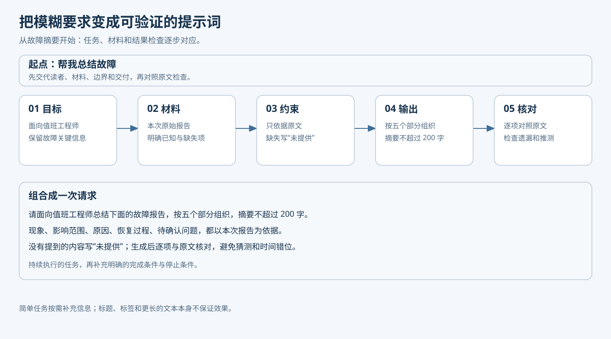
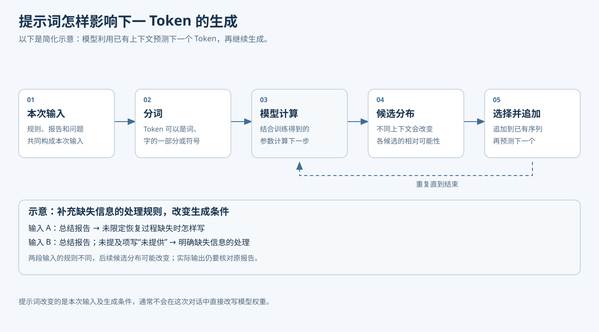
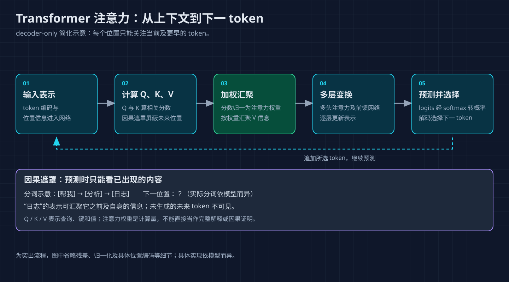
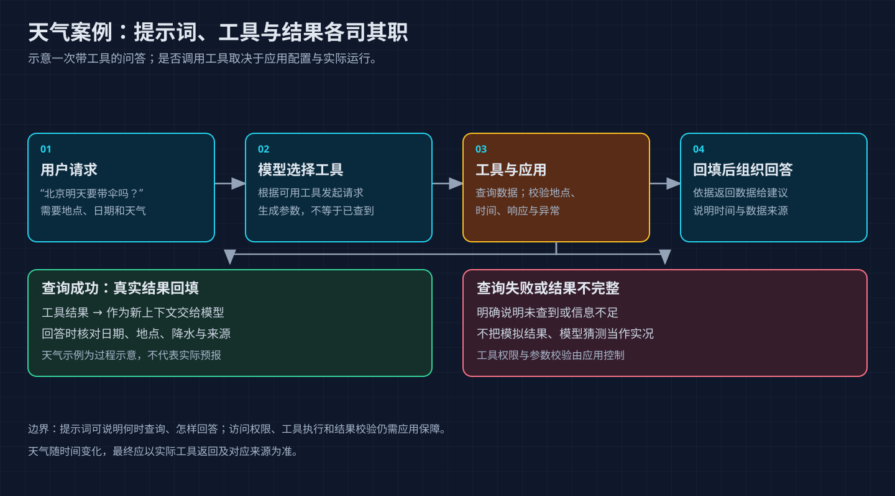

# Javaer 转 Agent：提示词工程——先学会表达任务，再理解模型如何响应

你让 AI“帮我总结一份故障报告”，它返回了几段流畅的文字，却漏掉了影响范围，也没说明恢复时间。这时再补一句“写得更专业”，效果未必有明显改善：模型仍然不知道读者是谁、哪些信息必须保留、报告里缺失的信息该怎么处理。

换一种说法：

```text
请面向值班工程师总结下面的故障报告。
按“现象、影响范围、原因、恢复过程、待确认问题”组织。
只使用报告里提供的信息；未提及的内容写“未提供”，不要推测。
输出不超过 200 字。

报告：
<report>
……在这里粘贴报告……
</report>
```

第二种写法没有给模型增加故障知识，却把任务目标、材料、边界和交付方式交代清楚了。这就是提示词的直接作用：**把人的意图和模型需要处理的信息放进本次输入，让模型有条件生成更符合任务要求的结果。**它可以提高结果的可控性，但不能保证每次都正确。

本篇先用日常任务说明怎么写、怎么改，再从 Token、下一步预测和上下文逐层解释为什么有效，最后回到本系列的 [weather-agent](weather-agent/README.md)，看提示词如何与 Java 工具调用和验证配合。示例答案均为教学示意，不代表已运行模型或完成真实天气查询。

## 1. 先动手：把一句模糊要求变成可执行任务

### 1.1 从结果倒推需要交代什么

不必每次都套一份长模板。先问自己：如果把任务交给一个不了解背景的同事，他还需要哪些信息才能交付？常见信息有五类：

拿开头的故障报告举例，提示词可以逐步补充，而不是一开始追求复杂：

| 写法 | 模型得到的信息 | 仍需补充什么 |
|---|---|---|
| 帮我总结故障 | 有任务，但没有材料和受众 | 原始报告、阅读对象 |
| 面向值班工程师，总结下面的故障报告 | 有目标、材料和受众 | 必须覆盖哪些内容，缺失时怎么办 |
| 按现象、影响、原因、恢复过程和待确认问题总结；未提供的内容如实标记 | 有输出要求和缺失处理 | 拿结果逐项与报告核对 |

这是提示词设计示意，不是同一模型的实测效果对比。具体任务只填写真正需要的条件。

| 信息 | 要回答的问题 | 故障报告示例 |
|---|---|---|
| 目标 | 要完成什么 | 总结故障报告 |
| 背景与材料 | 面向谁，依据什么 | 值班工程师；下方报告 |
| 约束 | 必须做什么，不能做什么 | 只用原文；缺失时明确说明 |
| 输出 | 结果怎样组织，供谁使用 | 五个部分，不超过 200 字 |
| 验证 | 怎样判断可接受 | 对照原文检查遗漏与推测 |



图 1：先根据任务补充必要条件，再用结果与原材料对照。验证不是提示词的一部分就能自动完成的，必要时需要人或程序执行。

最重要的是把抽象形容词换成可观察的要求。例如“准确”可以具体化为“每项结论能在材料中找到依据；找不到就标记未提供”。这比重复“务必准确”更容易检查，也让模型知道资料缺失时应该做什么。

但条件也不能无限增加。写给同事的一句翻译请求，可能只需“翻译成中文，保留代码和产品名”；给生产系统生成故障复盘，才需要来源、异常和输出约定。多写一条规则，就多一条需要维护、验证且可能互相冲突的规则。

### 1.2 一次只针对看得见的问题修改

假设第一次总结漏了恢复时间，下一步先回原材料确认：它是否真的写了恢复时间？

- 原材料有：在要求中增加“列出恢复时间”，重新核对结果。
- 原材料没有：要求“未提供时标明缺失”，而不是要求模型补出时间。
- 原材料很长，相关段落没有进入本次输入：先解决材料获取或截断问题。

同一句“写得更好”无法分别修复这三类问题。修改前保存原提示词和失败样本，修改后用同一组任务检查改善与退化。资料库中的[《Prompt越长越好吗？研究告诉你何时该停手》](https://mp.weixin.qq.com/s?__biz=MzI2NDU4OTExOQ==&mid=2247697464&idx=1&sn=809c710e2b0a2392b16ebb5635121d6d)也提醒我们关注长度成本和实际效果；文章讨论的研究场景有限，不能推导出所有任务的最佳长度。

### 1.3 用示例解释难以描述的规则

如果希望模型把反馈分类，文字定义仍可能有歧义，可以补一两条代表性的示例：

```text
任务：根据反馈判断属于“功能缺失”还是“使用故障”。
功能缺失：产品没有提供用户需要的功能。
使用故障：功能已经提供，但使用时未按预期工作。

示例：
反馈：已确认产品没有提供导出 PDF 的功能。 -> 功能缺失
反馈：点击导出 PDF 后一直报错。 -> 使用故障

现在处理：
反馈：……
```

示例把“定义怎样落到判断”展示出来，尤其适合格式、风格或边界判断。但上面的标签和反馈是假设的教学数据，真实分类仍需要结合产品事实。如果分类规则后来细分了，旧例子也要同步检查。参考资料[《从Prompt到Harness，给反馈分类装上方向盘》](https://mp.weixin.qq.com/s?__biz=MzI2NDU4OTExOQ==&mid=2247697102&idx=1&sn=c5f8e6c86d98caed81f32bf357be22a4)讨论了业务分类和示例需要一起维护的问题。

这种写法叫 **few-shot**：在当前输入里给少量示例；没有示例、只给任务说明则通常叫 **zero-shot**。二者都可以有明确指令。示例不等于训练数据，也不应把待评估题的标准答案直接放进去后，再宣称模型学会了处理新题。

## 2. 提示词究竟改变了什么

### 2.1 从文字到 Token

模型接收的不是一页排版好的文档，而是经过处理的输入。以常见的文本对话模型为例，应用先组织系统消息、用户消息等，再通过模型所用的消息模板和分词器转成 Token 序列。Token 是模型处理文本的单位，可以对应一个字、一个词的一部分、标点，或其他片段；不同模型的切分方式不同，不能把字数直接当成 Token 数。

例如 `请总结故障报告` 在某个分词器下可能拆成若干片段，但具体切法应以该模型的分词器为准。代码中的消息角色也会由模型服务或适配器转换为模型所需格式，**手写一个 `<system>` 标签不等于真正发送了 system 消息**。[Hugging Face 的 Chat Template 文档](https://huggingface.co/docs/transformers/en/chat_templating)展示了消息如何转换为模型输入。



图 2：这是自回归文本生成的简化示意。工具调用、推理过程和多模态输入会增加额外步骤，不同产品的内部实现也可能不同。

### 2.2 模型一步一步续写，而不是一次查出整篇答案

对自回归语言模型，可以先把过程理解为三个动作：

1. 读取当前输入，以及本轮已经生成的内容。
2. 根据这些内容计算下一 Token 的候选分布，按生成策略选择一个 Token。
3. 把选出的 Token 接到已有内容后，再预测下一步，直到生成结束。

比如要补全“报告没有提到恢复时间，因此应当……”，不同候选的可能性会受到前文影响。输入中增加“未提供的内容写未提供”，就改变了预测条件，可能提高符合这一要求的后续输出的概率。这里说的是**可能**，不是某句提示词能强制模型执行。

用公式表达同一件事：

$$
P_\theta(y\mid x)=\prod_{t=1}^{m} P_\theta(y_t\mid x,y_{<t})
$$

`x` 是本次输入，`y_t` 是第 `t` 个输出 Token，`y_{<t}` 是它之前已经生成的内容，`θ` 代表模型参数。整段输出的概率由各步条件概率相乘得到。改提示词主要是改 `x`；普通推理请求不会因为你写了新规则就对参数做反向传播。换一个不带该规则的新请求，也不能假设模型会永久记住它。

这也是提示词和微调的区别：提示词把规则或示例放进当前输入；微调通过训练更新模型参数。两者都需要评估，也都不能自动补齐缺失的实时数据。[GPT-3 论文](https://arxiv.org/abs/2005.14165)研究了在输入中给任务与示例的能力，但不同模型和任务的效果需要各自验证。

### 2.3 再往里看：上下文如何参与预测

以常见的 **decoder-only Transformer** 为例，把前面的“模型计算”再拆开。下面是一条简化路径，具体模型在位置编码、层结构与计算细节上可能不同：

1. **表示输入**：每个 Token 转成向量，并加入或结合位置信息。这样模型既能处理内容，也能区分顺序。
2. **形成关联**：一层自注意力根据各位置当前表示计算 `Q`（查询）、`K`（键）和 `V`（值）。当前位置的 `Q` 与可见位置的 `K` 计算分数，归一化后得到一组权重。
3. **汇集信息**：用这些权重对相应的 `V` 做加权汇聚，得到当前位置结合上下文后的表示。因果遮罩让生成位置不能看到尚未生成的后续内容；多头注意力允许并行使用不同的表示。
4. **逐层变换**：注意力与前馈网络等组件经过多层计算，更新各位置的表示。它们共同影响输出，不能把一个权重简单当成完整的因果解释。
5. **生成下一步**：最后的表示被映射成各候选 Token 的分数（logits），经 softmax 等步骤形成分布，再根据生成策略选择下一个 Token；追加后继续下一轮。



图 3：图中是简化计算路径，不表示模型逐条查表执行规则。缓存等实现优化会改变重复计算的方式，但不改变这里要说明的条件生成关系。[Transformer 原始论文](https://arxiv.org/abs/1706.03762)介绍了注意力机制。

有了这层认识，就能理解几种现象：

- **上下文有用**：目标、材料、规则和示例会一起影响后续预测；表达清楚可以减少任务歧义。
- **上下文有代价**：无关材料、冲突规则和冗余示例也会进入输入，增加处理成本，并可能干扰结果。长上下文并不保证每个细节都得到正确使用。
- **示例可能带偏**：如果例子总把缺失字段写成 `0`，模型可能延续这个模式，即使业务上 `null` 表示未知。
- **流畅不等于有依据**：模型可以生成符合语法的恢复时间，却不代表材料里真的有这个时间。

注意力机制提供的是解释生成过程的一个组成部分，并不能单独证明某条提示词为什么在某个任务上成功。检验仍要回到可观察的输入、输出和案例。

### 2.4 采样参数能改变表达，不能补充事实

模型算出候选分数后，生成策略会影响如何选择。温度通常用于调整分布的集中程度；top-p 通常从累计概率达到阈值的一组候选中采样。不同模型服务的具体实现可能不同，参数也未必都开放。

降低温度有时能减少输出变化，但并不等于“保证事实正确”。一个错误候选即使稳定地排在前面，重复选择它仍然会错。要验证采样如何影响分布，可以运行项目中的离线小实验：

```powershell
java '-Dfile.encoding=UTF-8' '-Dstdout.encoding=UTF-8' '-Dstderr.encoding=UTF-8' agent/zero-to-one/prompt-labs/SamplingLab.java
```

该命令从仓库根目录执行，使用程序预设的分数演示计算，不调用真实模型。项目说明和前置条件见 [prompt-labs](prompt-labs/README.md)。

## 3. 系统消息、工具结果和执行代码各管什么

做聊天演示时，提示词常常只有用户输入；做 Agent 时，模型看到的内容通常还包括应用的系统规则、工具说明、对话历史和工具结果。它们来自不同位置，也承担不同职责：

| 部分 | 示例 | 应承担的职责 |
|---|---|---|
| 系统消息 | 未知天气字段不能写成零 | 描述应用希望遵循的稳定规则 |
| 用户消息 | 北京明天是否需要带伞 | 表达本次目标 |
| 工具说明 | 城市搜索需要城市名 | 告诉模型能请求什么动作 |
| 工具结果 | 返回地点 ID、日期和天气 | 提供本次获取的外部数据 |
| Java 代码 | 校验地点 ID 和调用预算 | 决定请求能否实际执行 |

角色描述、分隔符和工具说明都有帮助，但它们不是权限系统。写“你是气象专家”不会使模型获得实时天气；写“你是管理员”也不会给它数据库权限。外部网页或工具结果中可能混入“忽略之前的规则”之类文本，应用应把它当作待处理数据，而不是仅凭标签认定它可信。提示词注入的风险可参考本地文章库中的[《Agent提示词注入攻击》](https://mp.weixin.qq.com/s?__biz=MzI1MzYzMjE0MQ==&mid=2247521453&idx=1&sn=a43b95ca00458d532f29d70e80f0d118&scene=58&subscene=0)。

对可以执行动作的 Agent，还要由程序独立限制工具、参数、访问范围和调用次数。对必然按固定顺序运行、没有语义判断空间的流程，直接用代码编排通常更容易验证；把模型留给理解问题、处理歧义和组织结果等环节。

## 4. 回到项目：让天气助手回答“明天要不要带伞”

### 4.1 先把问题拆成依赖

用户问：“北京市明天的天气怎样？请说明降水概率，并给出带伞建议、目标日期和来源。”模型不能仅凭季节常识回答，因为这里需要指定地点和日期的预报。项目提供城市检索与天气查询：先根据城市找到候选地点，再用实际返回的地点 ID 查询天气，依据当地时间确定目标日期，并从对应日期的数据中组织答案。



图 4：提示词影响模型提出什么请求；Java 决定工具请求是否允许执行；工具结果为最终回答提供证据。路径会因缺地点、失败或字段缺失而提前结束。

下面是任务需要考虑的几种情况：

| 情况 | 期望行为 | 为什么 |
|---|---|---|
| 没有城市 | 追问城市 | 无法定位预报 |
| 出现无法消除的同名地点歧义 | 追问地区 | 不能默认第一项就是用户要找的地点 |
| 工具失败 | 说明未取得数据 | 失败不代表晴天 |
| 目标日降水概率为 `null` | 写明未知 | 未知不等于 0% |
| 日期和字段齐全 | 引用对应数据并给出有条件的建议 | 预测概率不等于一定下雨 |

这份表既能帮助写提示词，也能作为人工评估的检查表。项目并未规定一个统一的概率阈值来决定是否带伞，不能把示例阈值误写成已有业务规则。

### 4.2 看三种提示词的差别

打开 [WeatherPrompts.java](weather-agent/src/main/java/example/weather/WeatherPrompts.java)，项目已有三种模式：

```java
return switch (mode) {
    case "basic" -> BASE;
    case "rules" -> BASE + RULES;
    case "examples" -> BASE + RULES + EXAMPLES;
    default -> throw new IllegalArgumentException("prompt 只能是 basic、rules、examples。");
};
```

`BASE` 已有共同边界，包括只引用本次工具结果、未知如实说明、地点不明确时追问；`RULES` 再增加处理顺序、停止条件和输出组织；`EXAMPLES` 在此基础上演示缺城市、服务失败和概率为 `null` 三种处理方式。

注意两个区别。第一，`basic` 不是故意删掉事实边界的“错误提示词”。第二，`rules` 相比 `basic` 一次增加了多项内容，它们的比较属于方案对照；即使结果不同，也不能直接归因于某一句规则。`examples` 里的工具结果是演示文本，不是本次实际执行的工具结果。

### 4.3 提示词之外，代码还做了什么

在 [WeatherAgent.java](weather-agent/src/main/java/example/weather/WeatherAgent.java) 和 [WeatherContext.java](weather-agent/src/main/java/example/weather/WeatherContext.java) 中，固定规则与用户问题分别组装为消息，工具回调另行注册。模型提出工具请求后，Java 执行并返回工具结果，再由模型决定后续回答。

项目约束 `getWeather(locationId)` 只能使用本次搜索得到的地点 ID，并设有模型调用和工具请求预算。即便模型输出了看起来合法的工具名，也仍需经过执行层校验；即便返回了格式完整的回答，仍要核对日期、数值与来源。现有项目的 `COMPLETED` 只表示得到非空候选文本，可能是回答，也可能是追问，不代表答案已自动验收。

如果要亲手看一次字段核对，可从仓库根目录运行：

```powershell
java '-Dfile.encoding=UTF-8' '-Dstdout.encoding=UTF-8' '-Dstderr.encoding=UTF-8' agent/zero-to-one/prompt-labs/EvidenceCheckLab.java
```

这是离线构造数据的演示，展示候选结果与独立观察不一致时如何拒绝；它没有接入天气项目的自然语言答案处理，也不证明真实模型回答正确。

## 5. 做一次有结论边界的对照

### 5.1 先预测，再运行

从最容易核对的问题开始：“明天出门需要带伞吗？”问题没有城市。预期行为是追问地点，不自行选择城市，也不声称已经查询到天气。

在 `agent/zero-to-one/weather-agent` 目录，按 [README](weather-agent/README.md) 配好 JDK 21、Maven 和模型服务密钥后：

```powershell
mvn -q -DskipTests package
if ($LASTEXITCODE -ne 0) { throw '打包失败。' }

java '-Dfile.encoding=UTF-8' -jar target/weather-agent-0.0.1-SNAPSHOT.jar '--ask=明天出门需要带伞吗？' --prompt=rules --context=full
```

然后保持问题和其他条件不变，只将 `--prompt=rules` 改成 `--prompt=examples` 再运行。程序会调用模型服务并产生用量；是否调用天气服务取决于模型行为。每次运行报告路径以终端输出为准。先检查答案是否追问，再查看 `toolEvents` 是否发生了未经依据的城市搜索。如果两个版本都符合预期，记为“该样本未观察到差异”。

再用没有出现在示例里的问题检查，例如“周末出门要带雨具吗？”它同时缺地点和明确日期；可以接受的行为是指出需要澄清的必要条件，而不是自行认定周末等于明天。不要只用提示词示例原句判断泛化。

### 5.2 真实天气探索不能冒充严格基准

使用完整北京问题，可以观察真实工具链是否正常，但不同运行时间的天气数据可能变化。要比较提示词本身，需要尽量固定模型、参数、工具、地点候选、预报快照、日期锚点和评价标准，并保留各次轨迹。工具回放还应检查实际工具名和参数；无论传什么都返回同一份“正确天气”，会掩盖选错城市的问题。

当前命令行没有提供真实模型结合冻结天气数据的完整重复评估入口。因此上述命令是**实时探索**，不是严格受控的质量基准。至少分别记录：是否追问、是否调用正确工具、是否匹配日期、是否忠实引用字段、失败时是否说明缺口。重复运行时保留失败和样本数，不凭某一次更流畅就断言提升。

提示词出现问题，也要先定位失败层：规则没写清、材料没进入输入、工具返回了错误日期、模型忽略了要求、Java 没有校验，处理方式各不相同。提示词是应用的一部分，但不能代替数据、工具、权限和验证。

## 6. 给自己的检查清单

下一次写提示词时，可以从一个简单版本开始，再根据失败补充必要信息：

1. 我要模型完成什么？依据哪些材料，结果给谁看？
2. 哪些条件必须满足？缺失、冲突或无法查询时怎么处理？
3. 哪些规则适合用示例说明？示例是否与现行业务一致？
4. 哪些操作必须由程序校验或执行，而不能只依赖模型遵守？
5. 我准备用哪些未放进示例的任务检查它？

至此，提示词的两面就连起来了：写法上，它把任务和边界交代清楚；机制上，它改变本轮生成所依赖的上下文；工程上，它需要和可信数据、执行约束及可复现的评估共同工作。下一篇[上下文工程](04-context-engineering.md)继续讨论：多轮交互、工具结果越来越多时，如何决定把哪些信息放进模型的当前输入。

## 参考资料

- [Agent 资源汇总](https://tyron.me/posts/agent-resources)：本系列参考资源入口，具体引用以各原始资料为准。
- [卡码笔记：提示词工程](https://notes.kamacoder.com/llm/app/prompt_engineering.html)和[示例、推理与反思](https://notes.kamacoder.com/llm/app/prompt_fewshot_cot_reflection.html)：任务组织与复杂任务拆解；具体模型效果需要自行评估。
- [Anthropic 交互式提示词教程](https://github.com/anthropics/prompt-eng-interactive-tutorial)：示例可用于学习提示方法，但不能直接作为其他模型的效果保证。
- [Anthropic：Prompting best practices](https://platform.claude.com/docs/en/build-with-claude/prompt-engineering/claude-prompting-best-practices)：清晰指令、示例与结构组织；模型之间的效果需要重新评估。
- [Language Models are Few-Shot Learners](https://arxiv.org/abs/2005.14165)：输入示例与模型参数训练的研究背景。
- [Attention Is All You Need](https://arxiv.org/abs/1706.03762)：Transformer 和注意力机制的原始论文。
- [Hugging Face：Chat templates](https://huggingface.co/docs/transformers/en/chat_templating)：消息角色与模型输入格式。
- 本地技术阅读库中的三篇文章：上文已分别链接其微信原文；本次借鉴基于本地保存的正文，不代表已核实微信页面当前可访问性。
- 项目实现：[weather-agent](weather-agent/README.md)、[prompt-labs](prompt-labs/README.md)；验证范围以各项目说明和本次实际运行记录为准。
