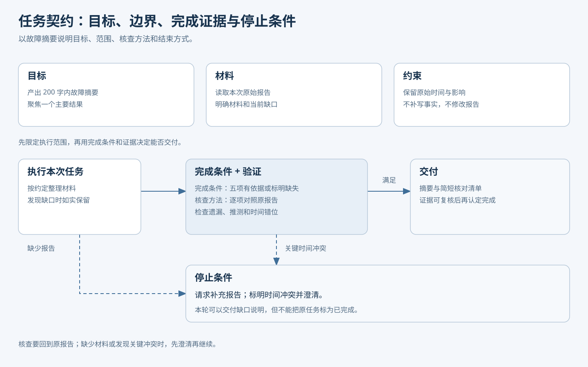
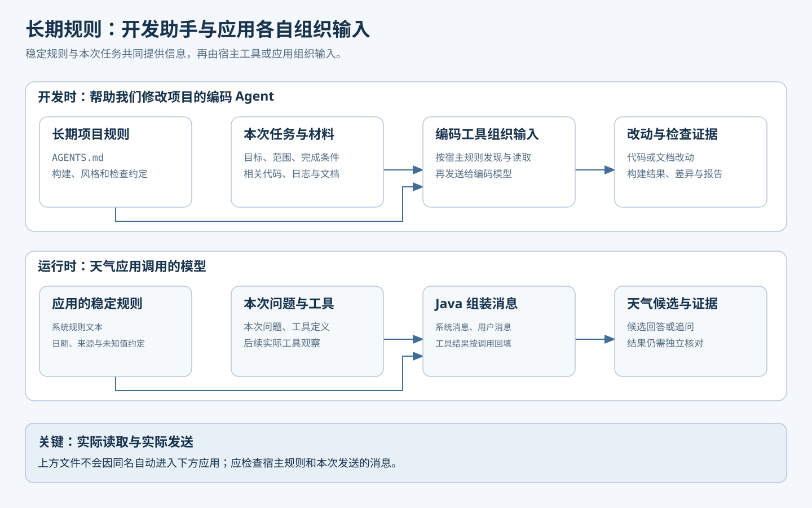
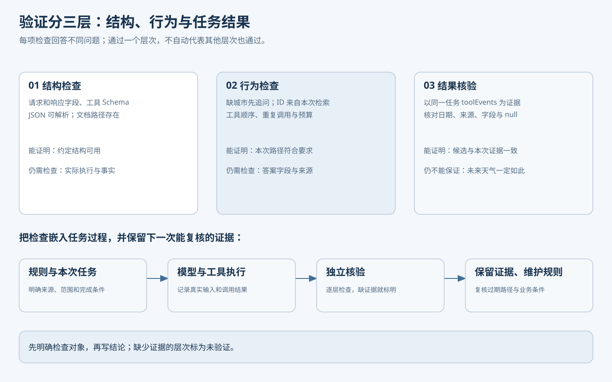

# Javaer 转 Agent：提示词工程——先学会表达任务，再理解模型如何响应

你让 AI“帮我总结一份故障报告”，它返回了几段流畅的文字，却漏掉了影响范围，也没说明恢复时间。这时再补一句“写得更专业”，效果未必有明显改善：模型仍然不知道读者是谁、哪些信息必须保留、报告里缺失的信息该怎么处理。

换一种说法：

```text
请面向值班工程师总结下面的故障报告。
按“现象、影响范围、原因、恢复过程、待确认问题”组织。
只使用报告里提供的信息；未提及的内容写“未提供”，不要推测。
输出不超过 200 字。

报告：
<report>
……在这里粘贴报告……
</report>
```

这段提示词交代了读者、材料、缺失信息的处理办法和输出要求。提示词的作用就在这里：**把任务及其条件说清楚，让模型知道这次要依据什么、怎样回答。**效果还需要用实际结果检查。

下面先把这份提示词写好，再从 Token 和逐步生成解释它为什么会影响回答，最后结合本系列的 [weather-agent](weather-agent/README.md)，看规则怎样进入请求、工具怎样执行、结果怎样核验。文中例子用于讲解，项目的实际验证范围见 README。

## 1. 先动手：把一句模糊要求变成可执行任务

### 1.1 从结果倒推需要交代什么

先想清楚要拿到什么结果，再补充模型完成任务所需的信息。开头的故障摘要，可以沿着图 1 检查：任务给谁看、使用什么材料、哪些内容不能补写、按什么方式输出，最后怎样核对。


图 1：先补齐任务条件，生成后再与原报告核对。核对可以由人或程序完成，不能只依赖模型自称“已检查”。

把形容词换成具体要求，通常更容易执行。例如，把“写得专业”改成“保留影响范围和原始时间；没有提及的内容写未提供”。这样既能指导生成，也能判断结果是否合格。

条件按任务需要添加即可。“翻译成中文，保留代码和产品名”可能已经足够；故障复盘涉及事实和未知项，才需要更细的约定。

### 1.2 一次只针对看得见的问题修改

假设第一次总结漏了恢复时间，下一步先回原材料确认：它是否真的写了恢复时间？

- 原材料有：在要求中增加“列出恢复时间”，重新核对结果。
- 原材料没有：要求“未提供时标明缺失”，而不是要求模型补出时间。
- 原材料很长，相关段落没有进入本次输入：先解决材料获取或截断问题。

同一句“写得更好”无法分别修复这三类问题。修改前保存原提示词和失败样本，修改后用同一组任务检查改善与退化。腾讯云开发者公众号文中的[《Prompt越长越好吗？研究告诉你何时该停手》](https://mp.weixin.qq.com/s?__biz=MzI2NDU4OTExOQ==&mid=2247697464&idx=1&sn=809c710e2b0a2392b16ebb5635121d6d)也提醒我们关注长度成本和实际效果；文章讨论的研究场景有限，不能推导出所有任务的最佳长度。

### 1.3 用示例展示期望的处理方式

有时规则写出来了，回答的粒度仍不符合预期。可以补少量示例，直接演示规则怎样落到文字上。下面只示范故障摘要中的“恢复过程”一项：

```text
规则：只依据报告提取恢复过程；未提及时写“未提供”。

报告片段：10:20 完成回滚，接口恢复。
恢复过程：10:20 完成回滚，接口恢复。

报告片段：数据库连接池耗尽，部分请求超时。
恢复过程：未提供。
```

第一条演示有依据时怎样摘取，第二条演示缺失时怎样处理。这些是教学材料，不是实际故障记录，也不是完整的五项摘要。

在输入里给少量任务示例，通常叫 **few-shot**；只给指令、没有演示样例，通常叫 **zero-shot**。示例应覆盖需要说明的边界，不必堆很多相似的成功答案。还要留出没有放进提示词的任务做检查，否则无法分清模型是在复述示例，还是能处理新问题。

示例也需要随规则更新。[《从Prompt到Harness，给反馈分类装上方向盘》](https://mp.weixin.qq.com/s?__biz=MzI2NDU4OTExOQ==&mid=2247697102&idx=1&sn=c5f8e6c86d98caed81f32bf357be22a4)讨论了分类规则变化后，旧示例可能继续引导错误判断的问题。

### 1.4 给持续执行的任务定义完成和停止条件

生成一段摘要，通常一轮就能结束。任务一旦包含查询、修改或反复重试，还要说清楚做到什么程度可以交付、遇到什么情况应暂停。这些约定可以组织成一份**任务契约**。

仍以故障摘要为例，把已有要求补上完成与停止条件：

```text
目标：面向值班工程师，生成不超过 200 字的故障摘要。
材料：只读取本次提供的报告，不查询外部资料。
约束：保留原始时间与影响范围；不修改报告，不补写事实。
完成条件：五个部分都有交代，有依据的内容忠实转述，未提及的写“未提供”。
核查方法：逐项对照原报告，检查遗漏、推测和时间错位。
交付：摘要与简短核对清单；清单不计入摘要字数。
停止条件：没有报告时请求补充；关键时间冲突时标明冲突并澄清。
```

“按五个部分输出”规定形式，“五项有依据或标明缺失”规定完成条件，“逐项对照原报告”规定核查方法。三者对应起来，才知道何时可以结束任务。



图 2：材料不足时先请求补充；执行中发现关键冲突时暂停并澄清。这是本轮的合理处理，不能冒充原任务已经完成。

这个组织方式借鉴了 [awesome-goal-prompts 的任务模板](https://github.com/majiayu000/awesome-goal-prompts/blob/main/templates/full-goal-template.md)。它可以直接写成普通任务文本，不需要固定的英文标签或斜杠命令。

## 2. 提示词究竟改变了什么

### 2.1 从文字到 Token

现在回到开头的问题：补上任务条件，为什么可能改变回答？先从模型处理文本的单位说起。

文本送入模型前，会经过分词器，转换成 **Token** 序列。一个 Token 可能对应一个字、词的一部分、标点或其他片段，具体切法因模型而异。因此，字数不能直接当成 Token 数。

规则、报告和用户问题都会以模型需要的格式进入输入。把“缺失内容写未提供”加进去，就改变了这次输入的序列。


图 3：输入经过处理后，模型逐步选择并追加 Token。下面先看这个循环，再进入“模型计算”内部。

### 2.2 模型一步一步续写，而不是一次查出整篇答案

对自回归语言模型，可以先把过程理解为三个动作：

1. 读取当前输入，以及本轮已经生成的内容。
2. 根据这些内容计算各候选 Token 的概率，按生成策略选择一个。
3. 把选出的 Token 接到已有内容后，再预测下一步，直到生成结束。

比如要补全“报告没有提到恢复过程，因此应当……”，不同候选的可能性会受到前文影响。输入中增加“未提供的内容写未提供”，就改变了预测条件，可能让后续输出更符合这个要求。

用公式表达同一件事：

$$
P_\theta(y\mid x)=\prod_{t=1}^{m} P_\theta(y_t\mid x,y_{<t})
$$

`x` 是本次输入，`y_t` 是第 `t` 个输出 Token，`y_{<t}` 是它之前已经生成的内容，`θ` 代表模型参数。整段输出的概率由各步条件概率相乘得到。改提示词主要是改 `x`；普通推理请求不会因为你写了新规则就对参数做反向传播。换一个不带该规则的新请求，也不能假设模型会永久记住它。

微调则通过训练更新参数，与这种利用当前输入的方式不同。[GPT-3 论文](https://arxiv.org/abs/2005.14165)研究了在输入中给任务与示例的能力；具体效果仍取决于模型和任务。

### 2.3 再往里看：模型怎样结合上下文

上一节把“根据输入计算下一步”当成一个整体。以常见的 **decoder-only Transformer** 为例，可以继续拆开来看。

首先，Token 被转换成向量，并结合位置信息。向量用于后续数值计算，位置信息帮助网络区分内容的顺序；此时还没有选出下一 Token。

接下来，一层自注意力根据各位置的表示计算 `Q`（查询）、`K`（键）和 `V`（值）。当前位置的 `Q` 与可见位置的 `K` 计算分数，归一化后得到注意力权重。

用这些权重对相应位置的 `V` 加权汇聚，当前位置的表示就结合了上下文信息。因果遮罩限制它只能使用当前及更早的位置。这里的权重分配在**上下文位置**上，还不是“下一个词该选谁”的概率。

经过多头注意力、前馈网络等组件的多层变换后，最后的表示才被映射成各候选 Token 的分数，称为 **logits**。softmax 把这些分数转换成合计为 1 的概率，再由生成策略选择下一 Token。


图 4：先表示输入，再汇集上下文，经过多层变换后预测下一 Token。图中省略了部分网络细节，具体模型实现可能不同。注意力机制的来源见 [Transformer 原始论文](https://arxiv.org/abs/1706.03762)。

回到故障摘要：任务规则、报告和示例都参与了这些计算，所以它们可以影响模型怎样处理“恢复过程”。给出示例时，模型利用的是本次上下文中的对应关系；无关材料、冲突规则和过期示例也可能干扰结果。

这解释了提示词为什么有用，也解释了为什么还要检查答案：改变输入只能影响生成，不能保证每条规则都被遵守。单个注意力权重也不足以证明某次回答为何正确或错误。

### 2.4 采样参数能改变表达，不能补充事实

模型算出候选分数后，生成策略会影响如何选择。温度通常用于调整分布的集中程度；top-p 通常按概率从高到低累计，保留达到阈值的一组候选，再从中采样。不同模型服务的具体实现可能不同，参数也未必都开放。

降低温度有时能减少输出变化，但并不等于“保证事实正确”。一个错误候选即使稳定地排在前面，重复选择它仍然会错。要验证采样如何影响分布，可以运行项目中的离线小实验：

```powershell
java '-Dfile.encoding=UTF-8' '-Dstdout.encoding=UTF-8' '-Dstderr.encoding=UTF-8' agent/zero-to-one/prompt-labs/SamplingLab.java
```

该命令从仓库根目录执行，使用程序预设的分数演示计算，不调用真实模型。项目说明和前置条件见 [prompt-labs](prompt-labs/README.md)。

## 3. 应用怎样把规则交给模型

理解了输入怎样影响生成，再看应用如何组织这些输入。

### 3.1 用消息角色保留来源和用途

在聊天界面里，我们直接填写的是用户消息。应用还可能提供系统规则、工具定义、历史消息和工具结果，它们承担不同职责：

| 部分 | 天气场景中的内容 | 职责 |
|---|---|---|
| 系统消息 | 未知字段不能写成零 | 提供应用的稳定规则 |
| 用户消息 | 北京明天是否需要带伞 | 表达本次目标 |
| 工具说明 | 城市搜索需要城市名 | 说明可以请求的动作 |
| 工具结果 | 地点 ID、日期和预报 | 提供本次取得的外部数据 |

消息角色由应用设置，再通过模型服务或适配器转换成相应输入格式。普通文本中的 `<system>` 标签不等于真正的 system 消息。[Hugging Face 的 Chat Template 文档](https://huggingface.co/docs/transformers/en/chat_templating)展示了这层转换。

外部资料即使用标签分隔，也可能夹带“忽略此前规则”之类指令。应用需要保留来源、说明资料用途，并独立限制工具参数、访问范围和调用次数。相关风险见本地文章库中的[《Agent提示词注入攻击》](https://mp.weixin.qq.com/s?__biz=MzI1MzYzMjE0MQ==&mid=2247521453&idx=1&sn=a43b95ca00458d532f29d70e80f0d118&scene=58&subscene=0)。

### 3.2 把跨任务的约定保存为长期规则

开发项目时，构建命令、代码约定和检查方法往往需要反复说明。可以把它们保存为长期规则。`AGENTS.md` 是一种给编码 Agent 提供项目说明的开放约定，没有强制字段，具体内容见[官方说明](https://agents.md/)。

下面是可用于天气模块的精简示意，并不表示模块已配置这个文件：

```markdown
# AGENTS.md

## 修改前
- 先读本模块 README，再读相关实现和调用方。
- 保留地点、日期、时区和未知值的业务含义。

## 检查与交付
- 在本模块目录运行：mvn -q -DskipTests compile。
- 源码移动时检查文档链接；交付时说明改动和验证范围。
```

这份文件指导**帮助我们开发项目的编码 Agent**。天气应用调用模型时，则由自己的 Java 代码组装规则、问题和工具结果。两个场景的输入由不同程序组织，不能因为项目里有 `AGENTS.md`，就认为天气模型已经收到了它。



图 5：稳定规则与本次任务分别提供信息，由宿主工具或应用汇集到输入中。天气项目的具体消息组装见第 4.3 节。

长期规则保留跨任务成立的约定，本次的目标、范围和完成条件放在任务说明里。当前进度、设计决策、排障经验可以另存，并在相关任务中读取。[centminmod 的配置](https://github.com/centminmod/my-claude-code-setup/blob/master/CLAUDE.md)为这些资料标注了读取时机。文件拆分与过期复核留到上下文工程篇展开。

## 4. 回到项目：让天气助手回答“明天要不要带伞”

### 4.1 先确定地点和日期，再引用预报

用户问：“北京市明天的天气怎样？请说明降水概率，并给出带伞建议、目标日期和来源。”模型不能仅凭季节常识回答，因为这里需要指定地点和日期的预报。项目提供城市检索与天气查询：先根据城市找到候选地点，再用实际返回的地点 ID 查询天气，依据当地时间确定目标日期，并从对应日期的数据中组织答案。

当前实现使用高德 Web 服务，工具只查询预报，不提供实况。高德预报接口没有降水概率字段，适配层把 `daily[].precipitationProbability` 保留为 `null`。所以这个问题的合格回答应明确说明概率未知，再依据查到的天气文字给出带条件的建议。接口字段见[高德天气文档](https://lbs.amap.com/api/webservice/guide/api/weatherinfo)，适配规则见 [WeatherTools.java](weather-agent/src/main/java/example/weather/tool/WeatherTools.java)。


图 6：提示词影响模型提出什么请求；Java 决定工具请求是否允许执行；高德结果回填后，模型才能据此组织候选。缺地点时先追问；查询失败或字段缺失时说明缺口，不以编造数据补齐流程。

把第 1.4 节的任务契约用于天气查询，可以得到以下分支：

| 情况 | 期望行为 | 核对证据 |
|---|---|---|
| 没有城市 | 追问城市，结束本轮等待补充 | 没有擅自搜索默认城市或声称已查到天气 |
| 出现无法消除的同名地点歧义 | 追问地区 | 城市候选与用户条件不足以选定唯一地点 |
| 工具失败 | 说明未取得数据 | 工具错误结果，不以失败推断晴天 |
| 目标日概率为 `null`，其他字段有效 | 写明概率未知，保留有效预报 | `precipitationProbability=null`，没有写成 0% |
| 地点、目标日期及可用字段已核对 | 给出预报、带条件的建议和来源，结束查询 | 日期与 `daily[].date` 匹配，引用字段与工具结果一致 |

表中既有完成条件，也有本轮需要停止或追问的情况。项目没有固定的带伞概率阈值，建议应说明依据与不确定性。

时间也需要对应到具体字段：应用查询时钟的当地时间 `localTime` 用于解释“明天”，`daily[].date` 是预报日期，`reportTime` 是服务发布时间，`retrievedAt` 是获取时刻。不能用一个时间替代另一个；`dayTemperature` 和 `nightTemperature` 分别是白天、夜间温度，也不能改称日最高、最低温度。

### 4.2 看三种提示词的差别

打开 [WeatherPrompts.java](weather-agent/src/main/java/example/weather/agent/WeatherPrompts.java)，项目已有三种模式：

```java
return switch (mode) {
    case "basic" -> BASE;
    case "rules" -> BASE + RULES;
    case "examples" -> BASE + RULES + EXAMPLES;
    default -> throw new IllegalArgumentException("prompt 只能是 basic、rules、examples。");
};
```

`BASE` 已有共同边界，包括只引用本次工具结果、未知如实说明、地点不明确时追问；`RULES` 再增加处理顺序、停止条件和输出组织；`EXAMPLES` 在此基础上演示缺城市、服务失败和概率为 `null` 三种处理方式。

`rules` 一次增加了多项内容，因此比较结果只能先归于整套方案，不能直接归因于某一句规则。`examples` 中的工具结果只是演示文本。

### 4.3 提示词之外，代码还做了什么

在 [WeatherAgent.java](weather-agent/src/main/java/example/weather/agent/WeatherAgent.java) 中，`WeatherPrompts.of(promptMode)` 提供固定规则，`question` 保留本次问题，工具回调另行注册。[WeatherContext.java](weather-agent/src/main/java/example/weather/agent/WeatherContext.java) 再把这两种文本分别组装为消息：

```java
this.prefix = List.of(new SystemMessage(system), new UserMessage(question));
```

当前项目直接使用 Java 常量，未从 `AGENTS.md` 读取应用规则。修改常量后，需要重新构建并重启服务，再从新报告确认发送的消息已经变化。

工具请求交给 Java 执行前，仍要经过参数和预算检查。例如，`getWeather(locationId)` 只接受本次搜索登记的地点 ID。可由代码确定的边界，交给程序执行；模型负责理解问题、处理歧义和组织回答。

### 4.4 按结构、行为和结果三个层次验证

检查一次回答时，要分清检查对象：

| 层次 | 天气案例中的检查对象 |
|---|---|
| 结构 | 请求和响应字段、工具参数结构、报告是否可读 |
| 行为 | 缺地点时是否追问、ID 是否来自本次检索、是否重复查询 |
| 结果 | 答案的地点、日期、时区、字段和未知值是否与工具证据一致 |



图 7：三层检查各有范围。结构合规后仍要看行为，行为合规后仍要核对结果；与预报证据一致，也不代表未来天气一定如此。

项目中的 `COMPLETED` 只表示模型产生了非空候选，可能是答案，也可能是追问。HTTP 200 和这个状态都不代表事实核验通过。应打开本次报告的 `rounds[].messages` 和 `toolEvents`，把候选与实际调用结果对照，而不是只检查答案是否写了“来源”。

可以从仓库根目录运行离线实验，观察日期错位、遗漏来源和未知值填零的候选怎样被拒绝：

```powershell
java '-Dfile.encoding=UTF-8' '-Dstdout.encoding=UTF-8' '-Dstderr.encoding=UTF-8' agent/zero-to-one/prompt-labs/EvidenceCheckLab.java
```

实验使用构造好的数据，不包含自然语言答案提取，也没有接入天气应用的验收流程。

同样，要按检查的实际范围描述结论。`mvn -q -DskipTests compile` 只能证明编译通过。[agent-ready-template](https://github.com/adongwanai/agent-ready-template/blob/main/template/AGENTS.md)中的[入口检查脚本](https://github.com/adongwanai/agent-ready-template/blob/main/template/scripts/verify-harness.mjs)检查文件与引用，[任务校验脚本](https://github.com/adongwanai/agent-ready-template/blob/main/template/scripts/validate-specs.mjs)检查示例 JSON 的 Schema；这些结构检查也不能替代业务验收。

## 5. 运行对照，检查提示词有没有帮助

### 5.1 先预测，再运行

从最容易核对的问题开始：“明天出门需要带伞吗？”问题没有城市。预期行为是追问地点，不自行选择城市，也不声称已经查询到天气。

在 `agent/zero-to-one/weather-agent` 目录，按 [README](weather-agent/README.md) 配好 JDK 21、Maven，并先编译：

```powershell
mvn -q -DskipTests compile
if ($LASTEXITCODE -ne 0) { throw '编译失败。' }
```

在 IDEA 中以 `example.weather.WeatherApplication` 启动服务，工作目录设为本模块，环境变量设置 `DEEPSEEK_API_KEY`，VM options 配置 `-Damap.api.key=你的Key`；真实密钥只保存在本机运行配置中，不写进提示词或报告。默认服务地址为 `127.0.0.1:8081`。随后打开 [requests.http](weather-agent/requests.http) 发送请求，或使用同样的 HTTP 请求体：

```http
POST http://127.0.0.1:8081/api/weather/ask
Content-Type: application/json

{
  "question": "明天出门需要带伞吗？",
  "promptMode": "rules",
  "contextMode": "full"
}
```

保持问题和其他条件不变，只将 `promptMode` 改成 `examples` 再发送。每个 POST 都是独立任务，不接续上一次请求。它会调用模型服务并产生用量；是否调用高德取决于实际行为。用响应中的 `taskId` 打开模块下的 `target/weather-runs/<taskId>/report.json`。先检查答案是否追问，再查看 `toolEvents` 是否发生了未经依据的城市搜索。如果两个版本都符合预期，记为“该样本未观察到差异”。

再用没有出现在示例里的问题检查，例如“周末出门要带雨具吗？”它同时缺地点和明确日期；可以接受的行为是指出需要澄清的必要条件，而不是自行认定周末等于明天。不要只用提示词示例原句判断泛化。

### 5.2 要比较效果，还需要固定条件

使用完整北京问题，可以观察真实工具链是否正常，但不同运行时间的天气数据可能变化。要比较提示词本身，需要尽量固定模型、参数、工具、地点候选、预报快照、日期锚点和评价标准，并保留各次轨迹。工具回放还应检查实际工具名和参数；无论传什么都返回同一份“正确天气”，会掩盖选错城市的问题。

当前项目没有提供真实模型结合冻结天气数据的完整重复评估入口。因此上述请求是**实时探索**，不是严格受控的质量基准。可以沿用前面的三层检查，逐题保留通过项、失败类型和重复次数，不凭某一次更流畅就断言提升。项目 README 另有单次真实运行记录，它能说明该次调用发生了什么，不能代替三种模式的受控质量对照。

发现失败后，再定位原因：规则没写清、材料没进入输入、工具数据错误或模型未遵守要求，各有不同的修复办法。

把确认有效的改动和失败样本保留下来，记录对应规则版本、模型与工具条件、验证时间。工具字段或业务规则变化时复核旧示例，源码移动时更新链接，让下一次修改有据可查。

## 6. 写完提示词，再检查四件事

1. 任务、材料和输出要求是否明确？缺失或冲突时怎样处理？
2. 完成条件和停止条件是否具体？有什么证据能判断已经做到？
3. 哪些边界由程序落实？结构、行为和结果分别怎样检查？
4. 哪些约定需要长期保存？示例、路径和规则是否仍然有效？

当对话变长、项目资料和工具结果增多，问题会从“这条规则怎样写”进一步变成“这次该提供哪些信息”。下一篇[上下文工程](04-context-engineering.md)继续讨论这个问题。

## 参考资料

- [Agent 资源汇总](https://tyron.me/posts/agent-resources)：本系列参考资源入口，具体引用以各原始资料为准。
- [卡码笔记：提示词工程](https://notes.kamacoder.com/llm/app/prompt_engineering.html)和[示例、推理与反思](https://notes.kamacoder.com/llm/app/prompt_fewshot_cot_reflection.html)：任务组织与复杂任务拆解。
- [Anthropic 交互式提示词教程](https://github.com/anthropics/prompt-eng-interactive-tutorial)：通过分步练习学习指令与示例的用法。
- [Anthropic：Prompting best practices](https://platform.claude.com/docs/en/build-with-claude/prompt-engineering/claude-prompting-best-practices)：清晰指令、示例与结构组织。
- [Language Models are Few-Shot Learners](https://arxiv.org/abs/2005.14165)：输入示例与模型参数训练的研究背景。
- [Attention Is All You Need](https://arxiv.org/abs/1706.03762)：Transformer 和注意力机制的原始论文。
- [Hugging Face：Chat templates](https://huggingface.co/docs/transformers/en/chat_templating)：消息角色与模型输入格式。
- [AGENTS.md 开放约定](https://agents.md/)：为编码 Agent 提供项目规则入口；具体读取方式取决于宿主工具。
- [awesome-goal-prompts：任务契约模板](https://github.com/majiayu000/awesome-goal-prompts/blob/main/templates/full-goal-template.md)：目标、约束、完成证据与停止条件。
- [centminmod：项目规则与记忆配置](https://github.com/centminmod/my-claude-code-setup/blob/master/CLAUDE.md)：长期资料按用途组织、按需读取的实践。
- [agent-ready-template](https://github.com/adongwanai/agent-ready-template)：规则、任务、契约、验证与证据的组织示例。
- [高德天气查询文档](https://lbs.amap.com/api/webservice/guide/api/weatherinfo)：当前天气工具的数据来源与接口字段。
- 本地技术阅读库中的三篇文章：上文已分别链接其微信原文。2026-10-28 核对时，三篇均跳转到验证码页；相关观点依据本地保存的正文，保留原文链接供完成验证后复核。
- 项目实现：[weather-agent](weather-agent/README.md) 的天气工具与消息循环、[prompt-labs](prompt-labs/README.md) 的两个离线实验。
