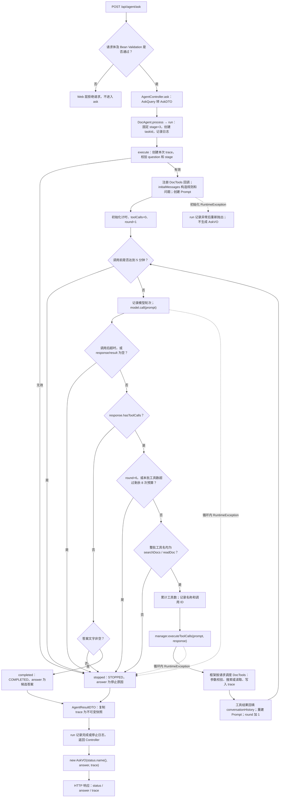
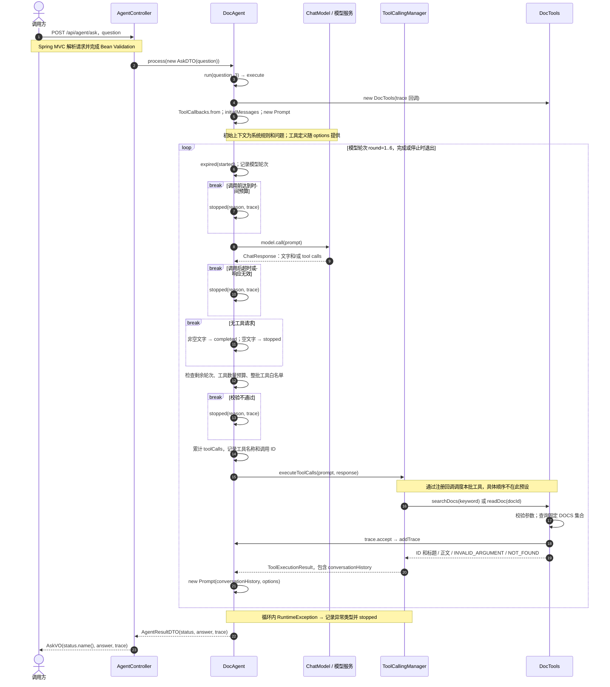

# AgentController.ask 调用逻辑

本图基于当前工作区源码静态阅读，入口是 `POST /api/agent/ask`，只展开 HTTP 固定使用的 `stage=3`。没有运行线上模型；工具请求的名称、参数、顺序和轮次取决于实际模型响应。

主调用链：`AgentController.ask → DocAgent.process → run(question, 3) → execute → model.call / manager.executeToolCalls → AgentResultDTO → AskVO`。

## 调用流程图

图中异常虚线标出主要入口；`execute` 的循环 `try` 内其他 `RuntimeException` 同样进入停止分支。初始化阶段位于该 `try` 外，其异常由 `run` 记录并重新抛出。`output` 若为空而触发运行时异常，也走循环异常分支。

## 关键交互时序图

下图描述参数有效时的交互；`break` 表示退出本次处理。工具批次可能请求任意一个获准工具，也可能请求多个工具；图中没有预设“先搜索、再读某份文档”的实际轨迹。

## 对照源码阅读

| 阅读顺序 | 源码位置 | 重点 |
|---|---|---|
| 1 | [AgentController.ask](C:/Users/xiaotian/Documents/github/hello-ai/agent/zero-to-one/first-agent/src/main/java/example/agent/web/AgentController.java:25) | 只做 Query → DTO 和结果 → VO 转换 |
| 2 | [AskQuery](C:/Users/xiaotian/Documents/github/hello-ai/agent/zero-to-one/first-agent/src/main/java/example/agent/web/query/AskQuery.java:11) | question 非空白，最长 1000 字符 |
| 3 | [DocAgent.process](C:/Users/xiaotian/Documents/github/hello-ai/agent/zero-to-one/first-agent/src/main/java/example/agent/service/DocAgent.java:54) | 固定进入 stage=3；HTTP 无法指定其他阶段 |
| 4 | [DocAgent.run](C:/Users/xiaotian/Documents/github/hello-ai/agent/zero-to-one/first-agent/src/main/java/example/agent/service/DocAgent.java:72) | taskId、耗时、完成/停止日志、初始化异常重抛 |
| 5 | [DocAgent.execute](C:/Users/xiaotian/Documents/github/hello-ai/agent/zero-to-one/first-agent/src/main/java/example/agent/service/DocAgent.java:100) | 输入校验、工具注册和全部循环逻辑 |
| 6 | [模型调用与响应判断](C:/Users/xiaotian/Documents/github/hello-ai/agent/zero-to-one/first-agent/src/main/java/example/agent/service/DocAgent.java:158) | 是否继续取决于 hasToolCalls；同时返回文字和工具请求时优先处理工具 |
| 7 | [工具校验、执行与历史回填](C:/Users/xiaotian/Documents/github/hello-ai/agent/zero-to-one/first-agent/src/main/java/example/agent/service/DocAgent.java:184) | 先整批检查，再执行；下一轮必须使用更新后的历史 |
| 8 | [DocTools.searchDocs](C:/Users/xiaotian/Documents/github/hello-ai/agent/zero-to-one/first-agent/src/main/java/example/agent/tool/DocTools.java:42) | 仅按标题包含关系匹配，返回 ID 和标题，不返回正文 |
| 9 | [DocTools.readDoc](C:/Users/xiaotian/Documents/github/hello-ai/agent/zero-to-one/first-agent/src/main/java/example/agent/tool/DocTools.java:68) | 按精确 ID 读取固定资料；不是文件系统或数据库读取 |
| 10 | [AgentResultDTO](C:/Users/xiaotian/Documents/github/hello-ai/agent/zero-to-one/first-agent/src/main/java/example/agent/dto/AgentResultDTO.java:12) | COMPLETED / STOPPED；trace 复制为不可变快照 |

几个容易看错的地方：

- **循环发生在本次请求内部。** 每次 POST 都重新创建消息、工具实例、预算和轨迹，没有跨请求对话记忆。
- **模型返回的是工具请求。** Java 检查白名单和预算后，由 Manager 通过回调执行 `DocTools`。源码里没有 `execute → searchDocs` 的普通直接调用语句，因此静态调用图需结合工具注册关系阅读。
- **两种回填作用不同。** `conversationHistory` 供下一轮模型使用；`trace` 供调用方查看执行记录，工具输出会写入其中。
- **最多 6 次 `model.call`、8 次工具请求。** 第 6 轮如果还请求工具，会直接停止，因为已无后续模型轮次读取工具结果。一次响应的工具请求按整批计入预算。
- **5 分钟预算在模型调用前后检查。** 它不会主动中断阻塞中的调用，也不是独立定时取消器；工具批次结束后，到下一轮开始才再次检查。
- **工具参数错误或未找到资料不等于立即停止。** 工具返回 `INVALID_ARGUMENT` / `NOT_FOUND` 字符串，回填后模型仍可修正或给出回答。
- **COMPLETED 只表示得到非空候选答案。** 代码不强制至少调用一次工具，也不自动核验事实。STOPPED 的 `answer` 字段存放停止原因。

本项目 `pom.xml` 指定 Spring AI 2.0.1。Spring AI 2.0 已移除 `ChatModel` 内部工具执行循环；这里直接使用 `ChatModel` 和 `ToolCallingManager` 的手动循环与该机制一致。依据：[Spring AI 官方升级说明](https://docs.spring.io/spring-ai/reference/upgrade-notes.html)。

## GitHub skill / 项目选择

以下是仓库文档核验后的建议，未安装或实测这些第三方工具。第三方模板的版式和工作流未套用到本项目。

| 项目 | 仓库已说明的能力 | 对本次需求的建议 |
|---|---|---|
| [plearaj/code-flow-skill](https://github.com/plearaj/code-flow-skill) | 沿入口追踪调用链；生成 Mermaid、Markdown、JSON 和可交互 HTML；提供 Java tracer 与源码位置 | **需要持续生成“方法入口 → 全链路文档”时优先考虑。** 仓库流程还包含补充源码注释；使用前应按你的要求限制为只读分析和图文输出 |
| [yunusemregul/callgraph](https://github.com/yunusemregul/callgraph) | IntelliJ IDEA 方法调用图；节点跳转定义，边跳转调用位置；支持展开调用关系和导出 HTML | **主要在 IDEA 中边看图边读 Java 时优先考虑。** 将光标放在 ask 上，右键 Generate Call Graph，或按 Alt+Shift+E；应查看 callees 方向以向下追踪 |
| [Trail of Bits diagramming-code](https://github.com/trailofbits/skills/blob/main/plugins/trailmark/skills/diagramming-code/SKILL.md) / [Trailmark](https://github.com/trailofbits/trailmark) | 从解析后的代码图生成 Mermaid 调用图、类关系图和依赖图；Trailmark 支持 Java | **需要可重复生成的静态代码关系图时考虑。** 需要 Trailmark 环境；本项目的工具回调关系仍应对照注册点核验 |

对这段代码，建议将自动生成的调用图用于定位方法，将本文件的流程图和时序图用于理解分支、预算及历史回填。静态方法边本身不能证明某次请求实际走过的工具路径；实际路径需要对应请求的 `trace` 或运行日志。
